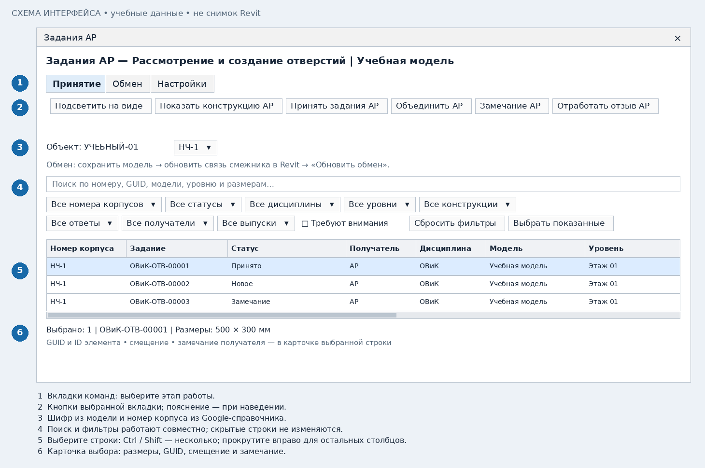

# АР: отдельно принять задания в архитектурной модели

[Общая подготовка](common.md) · [К выбору роли](README.md)

## 1. Начните после согласования конструктивных отверстий

ВИС выдаёт задания АР отдельно от КР. Откройте свою модель АР, обновите связи ВИС
после их сохранения и нажмите **«Обмен» → «Обновить обмен»**.
Проверьте шифр объекта; подключите токен АР. Окно АР показывает адресованные
этой модели задания АР. Решения и история КР остаются независимыми.

## 2. Проверьте входящие задания

Отфильтруйте номер корпуса, уровень и статус. Выберите строку и нажмите
**«Показать конструкцию АР»**. Проверьте, что задание относится к нужной стене
или перекрытию текущей модели; сравните размеры и ревизию в таблице и карточке.
Двойной клик также показывает конструкцию.

## 3. Примите, объедините или запишите замечание

| Кнопка | Когда применять |
|---|---|
| Принять задания АР | Создать/обновить отдельные проёмы для выбранных заданий |
| Объединить АР | После проверки предпросмотра сделать один совместимый проём для нескольких заданий |
| Замечание АР | Отклонить выбранные задания с конкретной причиной для ВИС |
| Отработать отзыв АР | После получения явного отзыва удалить ранее созданные отверстия с подтверждением |
| Подсветить на виде | Показать уже созданный местный проём на сохранённом инструментом подходящем виде, если такой вид имеется |

Нельзя объединять задания разных корпусов или несовместимых конструкций.
При изменении контура существующего отверстия программа проверяет связанные
марки и размеры. Небезопасная замена блокируется, чтобы сохранить оформление.

## 4. Передайте результат ВИС

Сохраните/синхронизируйте модель АР. ВИС обновляет вашу связь, нажимает
«Обновить обмен», проверяет проёмы и выполняет «Подтвердить результат АР».
Выдачи и решения фиксируются в Google автоматически. Замечание на прошлую
ревизию не заменяет проверку актуальной перевыдачи.

## Что сейчас выполняется отдельно

Автоматическое вырезание отделки по уже согласованным отверстиям связанной модели
КР этой командой не выполняется. Для отверстий АР нужны отдельные задания ВИС-АР.
В интерфейсе АР нет команд КР «Планы плит» и «Разрезы стен»; «Подсветить на виде»
сама не создаёт вид. Если подходящего сохранённого вида нет, используйте
«Показать конструкцию АР» для навигации. Не создавайте повторное отверстие только ради просмотра.

## Если ВИС перевыдал задание

Обновите связь ВИС и обмен. Найдите изменённую ревизию через фильтр статуса
или «Требуют внимания», проверьте изменение и повторно примите либо назначьте
замечание. Сохраните АР, чтобы ВИС увидел актуальное решение.
