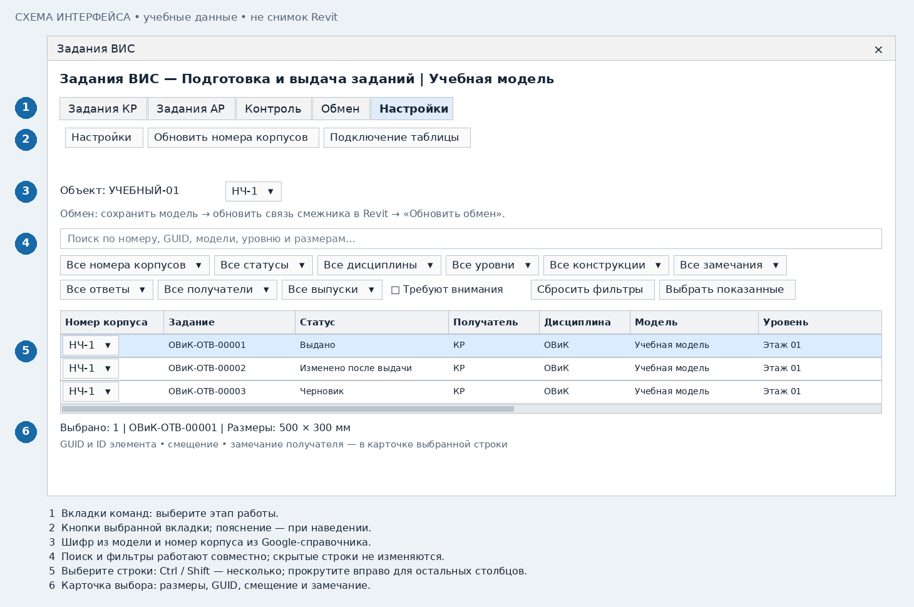
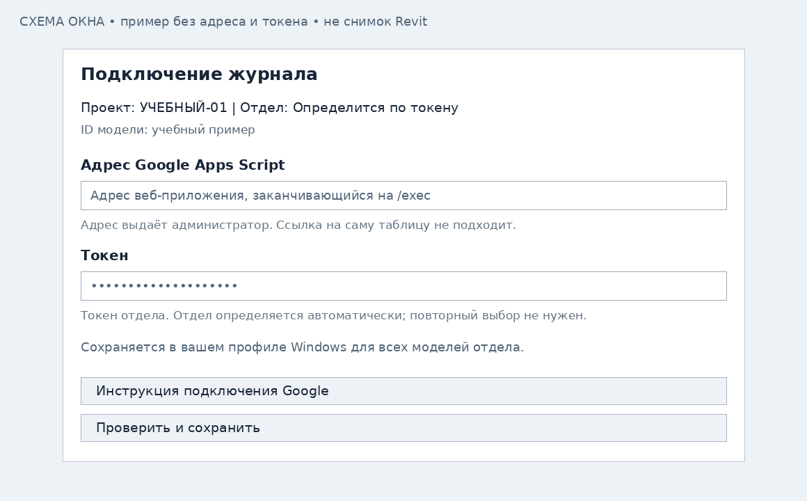

# Общее: подключение и работа с таблицей

[К выбору роли](README.md)

## 1. Откройте интерфейс своей роли

На панели «Задания отверстий» откройте ВИС, КР или АР. Работайте в своей модели.
При смене документа вернитесь в исходную модель или закройте окно и откройте заново.

На схемах: **1** — вкладки, **2** — команды, **3** — шифр и корпус,
**4** — поиск и фильтры, **5** — таблица, **6** — карточка выбранной строки.

## 2. Подключите Google один раз

Откройте **«Настройки» → «Подключение таблицы»**. Получите адрес Apps Script и токен
своего отдела у администратора. Это не адрес самой Google-таблицы.

1. Вставьте адрес веб-приложения с окончанием /exec.
2. Введите токен отдела: ОВиК, ВК, ЭОМ, СС, АК, КР или АР.
3. Нажмите «Проверить и сохранить». Отдел определяется автоматически по токену.

Подключение сохраняется в вашем профиле Windows для всех моделей отдела.
В RVT токен не записывается. На другом компьютере подключение вводится заново.
Обычному сотруднику достаточно права просмотра таблицы; запись из Revit разрешает токен.

## 3. Проверьте шифр и выберите номер корпуса

Шифр берётся из «Сведений о проекте»: по умолчанию «Номер проекта» либо параметр,
указанный в настройках. ВИС, КР и АР одного объекта используют одинаковый шифр.
Выберите номер корпуса в списке, например НЧ-1 или ПЧ-1. Обозначение НЧ/ПЧ сохраняется.
Список поступает из листа Google «Части объектов». Команда «Обновить номера корпусов»
перечитывает изменения. Вручную придумать отсутствующий вариант в окне нельзя.

Для номеров 1-2, 6-7 и 01 столбец «Номер корпуса» должен иметь текстовый формат.
После обновления Code.gs запустите setupJournal; уже превращённые в даты номера
введите заново и обновите список в Revit. Подробности — в инструкции Google.

## 4. Настройки параметров

**ВИС:** укажите JSON задания, статус выдачи, семейство бокса, параметры размеров
для ширины, глубины и высоты. Фильтр конструкции необязателен, к статусу не относится. Имена выбираются по параметрам модели; произвольные
имена из примеров копировать не нужно. Семейство должно поддерживать размещение
на уровне или рабочей плоскости и запись размеров.

**КР/АР:** отдельное семейство бокса для принятия не нужно. JSON-параметр у проёма
необязателен: внутренняя связь с заданием хранится автоматически.

Отдельные параметры ревизии, номера выпуска и даты выдачи в ВИС необязательны.
Для таблицы окна и Google данные берутся из JSON. Для отдельных столбцов обычной
спецификации Revit заполните эти три настройки. Статус нужен для раскраски.

## 5. Как найти отверстие

Введите номер, GUID, модель, уровень или размеры в поиск. Примените фильтры корпуса,
статуса, дисциплины, уровня, конструкции, ответа, получателя, выпуска и номера замечания.
Флажок «Требуют внимания» помогает найти незавершённые и проблемные задания.
«Сбросить фильтры» возвращает весь список; «Выбрать показанные» выбирает только видимые строки.

Клик по строке выбирает её в таблице и показывает карточку снизу. Сам по себе клик
не включает подсветку в модели. Для неё используйте **«Подсветить на виде»**:
откроется ранее созданный вид, элемент выделится и экран приблизится к нему.
Если видов несколько, выберите нужный. Несколько элементов должны быть видны на одном виде.
Команда не создаёт новый вид. У ВИС также доступен отдельный «Бокс в 3D».

## 6. Обновляйте обмен правильно

1. Сохраните/синхронизируйте свою модель после выдачи или решения.
2. Обновите RVT-связь смежника штатной командой Revit.
3. Откройте вкладку «Обмен» и нажмите «Обновить обмен».

Эта кнопка перечитывает загруженную связь, а не обновляет её с диска.
«Открыть таблицу» открывает Google-журнал. Выдачи и решения отправляются автоматически;
при сбое сети очередь повторяет отправку в фоне без уведомлений. Для фоновой отправки
Revit должен быть запущен. Геометрия смежника всё равно требует обновления RVT-связи.

## Если что-то не получилось

| Сообщение / ситуация | Действие |
|---|---|
| Создано 0, есть пропуски или ошибки | Раскройте подробности итогового сообщения; причины и ссылки на элементы есть в окне вывода |
| Действие не выполнено | Раскройте подробности и передайте полный traceback вместе с названием команды |
| Связь не загружена | Загрузите нужную связь и обновите обмен; это не означает удаление проёма |
| Луч вниз не нашёл опору | Проверьте выбранную модель и наличие перекрытия/фундамента на вертикали под отверстием |
| Нельзя выбрать уровень | Проверьте равноудалённые уровни и корпуса; отметка сравнивается с конструкцией, а не высотой бокса |
| HTTP 401 при подключении | Администратор проверяет развёртывание Apps Script: выполнять от владельца, доступ «Все», адрес /exec |
| Не найден созданный вид | Создайте виды контроля доступной командой роли или выберите существующий подходящий вид |

Не повторяйте выдачу только из-за задержки Google: сначала проверьте состояние задания в модели.
