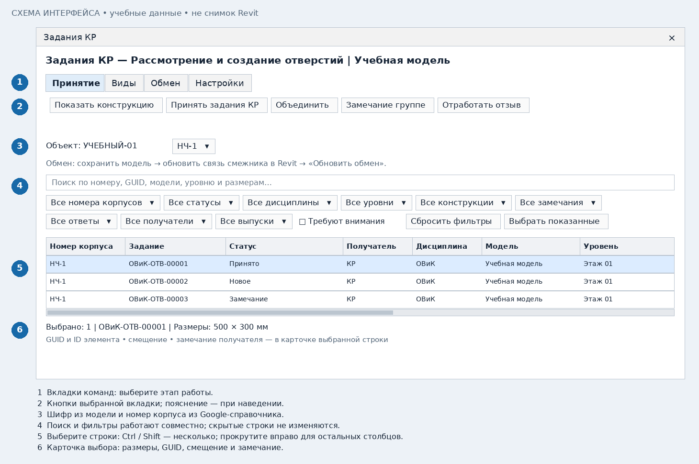
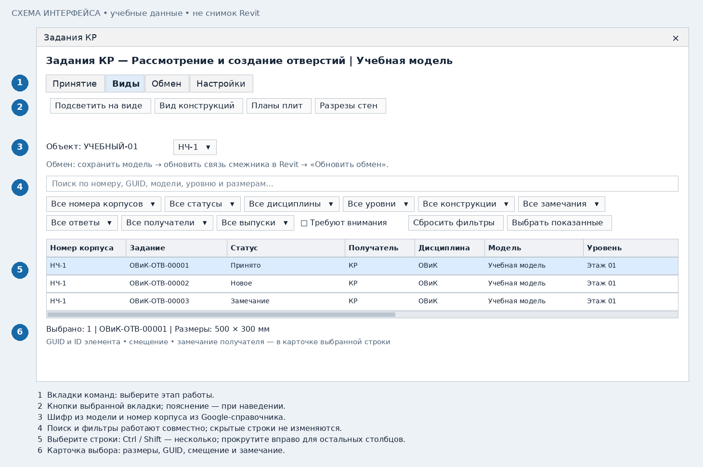

# КР: принять задания и создать отверстия

[Общая подготовка](common.md) · [К выбору роли](README.md)

## 1. Получите актуальные задания

Откройте свою модель КР. Убедитесь, что ВИС сохранил/синхронизировал выдачу.
Обновите связи инженерных моделей штатной командой Revit.
Откройте КР → **«Обмен» → «Обновить обмен»**.
Шифр объекта должен совпадать с ВИС. Подключите токен КР для Google-журнала.

## 2. Выберите строки и проверьте конструкцию

В окне видны только адресованные текущей модели задания КР. Используйте фильтры
корпуса, уровня, дисциплины и статуса; включите «Требуют внимания».
Выберите строку и нажмите **«Показать конструкцию»**. Двойной клик также показывает конструкцию.
В нижней карточке сравните ранее принятые и текущие размеры, прочитайте замечание и ревизию.

## 3. Примите отдельно или объедините

- **«Принять задания КР»** создаёт или обновляет отдельное отверстие по каждому выбранному заданию.
- **«Объединить»** показывает предпросмотр общего отверстия. Проверьте общий габарит и подтвердите.

Объединение возможно для совместимых заданий одной конструкции, модели и корпуса;
задания разных корпусов в один проём не объединяются. Не выбирайте всю таблицу без проверки.
Перед изменением существующего отверстия проверяется безопасность связанных марок и размеров.
Если замена затронет оформление, операция блокируется и показывает причину.

Отверстия создаются как нативные проёмы Revit. Для нестандартных, наклонных или
неподдерживаемых конструкций потребуется отдельная проверка. После принятия
сохраните/синхронизируйте КР: ВИС должен обновить вашу связь, чтобы увидеть результат.

## 4. Назначьте замечание или отработайте отзыв

**«Замечание группе»** записывает одну причину для всех выбранных заданий и общий номер замечания. Укажите,
что именно нужно исправить: положение, размер или конструкцию. Сохраните модель.
После новой выдачи ВИС обновите связь и примите актуальную ревизию.

**«Отработать отзыв»** применяется только к отозванным заданиям: после проверки
подтвердите удаление ранее созданных отверстий. Произвольное удаление проёма вручную
отобразится у ВИС как проблема, а не как согласованный отзыв.

## 5. Создайте виды контроля

Откройте **«Виды»**:

| Кнопка | Назначение |
|---|---|
| Планы плит | Создать/обновить планы по уровням для контроля принятых отверстий в плитах |
| Разрезы стен | Создать/обновить разрезы прямых стен с отверстиями; выбранные строки ограничивают набор стен |
| Подсветить на виде | Открыть ранее созданный подходящий вид, выделить проём и приблизить к нему |
| Вид конструкций | Подготовить вспомогательный 3D-вид конструкций для просмотра в связи ВИС; это необязательная подготовка |

Если выбраны несколько заданий объединённого проёма, подсвечивается один фактический проём.
Если на одном созданном виде не видны все выбранные элементы, сузьте выбор.
Для разрезов стен без выбранных строк обрабатываются стены с принятыми отверстиями проекта.
Собственные виды инструмента обновляются; пользовательские виды не заменяются.

«Вид конструкций» не обязателен для запуска «Бокс в 3D» у ВИС. При использовании
этого вспомогательного вида сохраните КР и обновите связь в инженерной модели.

## 6. Завершите обмен

Проверьте незакрытые задания через «Требуют внимания». Сохраните/синхронизируйте КР
и сообщите ВИС, что нужно обновить связь. Решения автоматически отправляются в Google.
ГИП видит сводные даты и количество актуальных принятий, замечаний и неотработанных отзывов.
ВИС отдельно проверяет и подтверждает соответствие результата выданным заданиям.

## Групповое замечание для разных разделов

1. Выберите строки группы с Ctrl/Shift, например задания ОВиК, ВК и ЭОМ.
2. Нажмите **«Замечание группе»** и один раз введите причину.
3. Сохраните/синхронизируйте КР. В журнале решений у всех заданий будет общий
   номер вида КР-ЗМ-001 и GUID группы; номер считается внутри этой модели КР и проекта.
4. После исправления ВИС обновите связи и «Обновить обмен». Примите актуальные
   ревизии отдельно либо совместимыми объединениями.

Всё замечание закрывается только после принятия актуальных заданий группы
или отработки их явных отзывов по последним загруженным данным. Частичное
принятие оставляет группу открытой. Кнопка работает и для одного задания.
Для уже реализованного объединённого проёма выберите все входящие в него задания:
назначение замечания не удаляет существующий проём и сохраняет его связь.
Номер можно выбрать в фильтре «Все замечания». У ВИС команда «Показать группу»
покажет свои задания этого замечания на созданном виде контроля.
