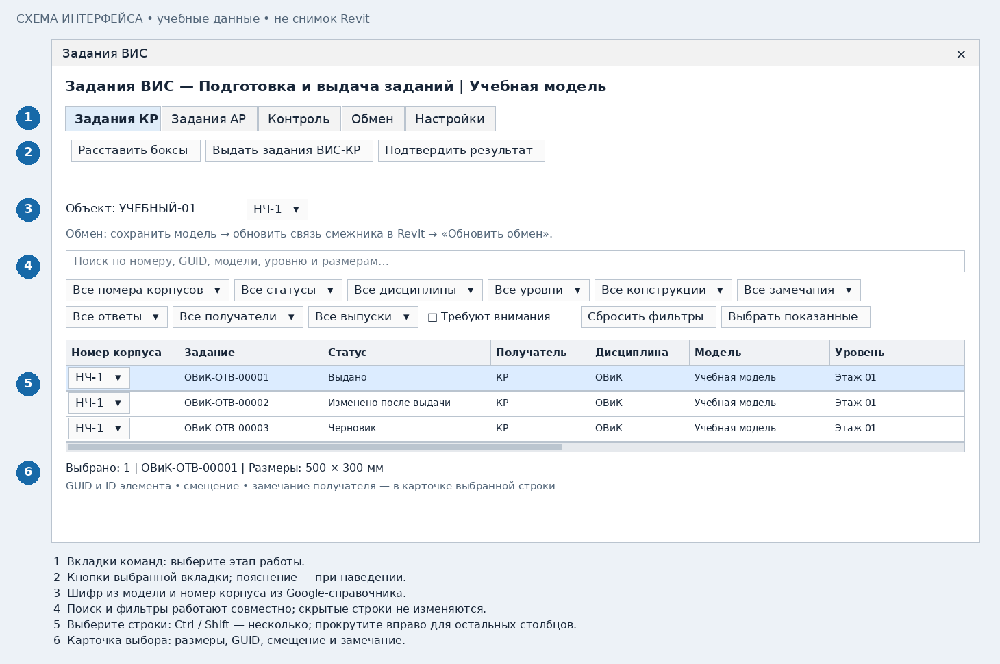
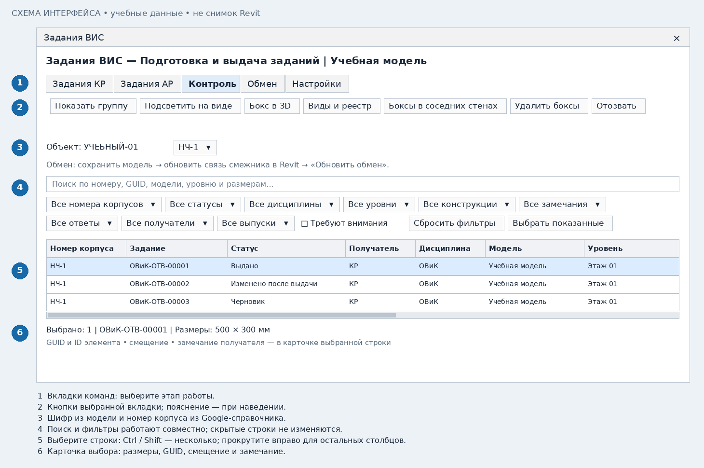
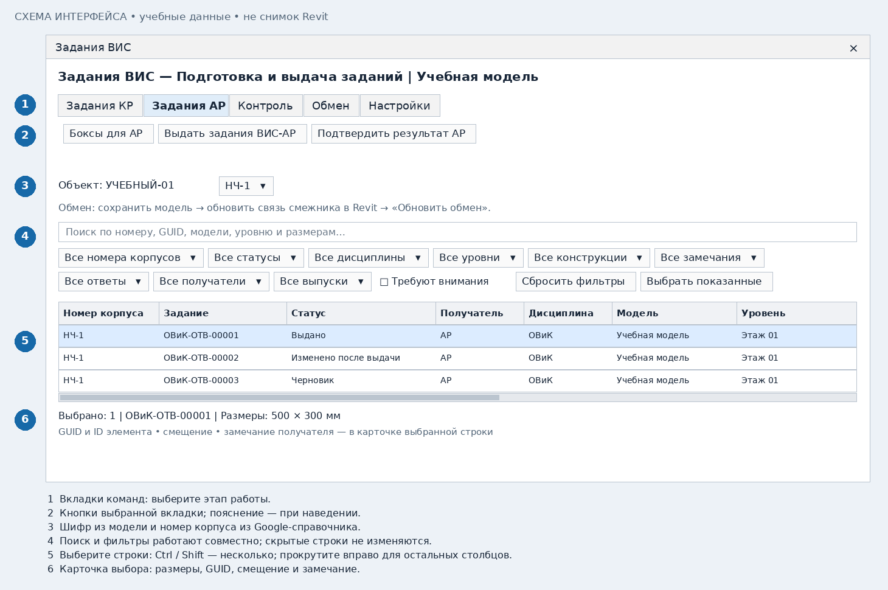

# ВИС: расставить и выдать задания

[Общая подготовка](common.md) · [К выбору роли](README.md)

## 1. Выберите корпус и проверьте настройки

Откройте ВИС в своей инженерной модели. Подключите токен своего отдела, проверьте
шифр объекта и выберите номер корпуса. Для новой расстановки номер корпуса обязателен.
Проверьте семейство, параметры размеров, JSON и статус выдачи.

## 2. Расставьте боксы для КР

Откройте **«Задания КР» → «Расставить боксы»**. Сначала проверьте мнемосхему EIR/ЗНП и нажмите «Продолжить». Затем выберите охват: весь проект, области видимости (если есть) или ручной выбор. В ручном режиме выберите прямые лотки,
воздуховоды, трубы или кабельные трубы текущей модели, затем нужную связь КР,
тип бокса и рабочий набор, если требуется. Фильтр выбора исключает неподдерживаемые
элементы; факт пересечения проверяется геометрией после выбора.

Прямые коммуникации могут проходить под наклоном через вертикальные стены
и горизонтальные перекрытия. Учитываются сечение на входе/выходе, поворот сечения
и смещение по толщине конструкции. Кривые и гибкие участки, фасонные части
автоматом не рассчитываются. Наклонные стены требуют отдельного способа вырезания;
такие пересечения пропускаются с причиной.
Для труб/воздуховодов учитывается наружная изоляция, круглое сечение описывается прямоугольным габаритом.

После расчёта проверьте количество созданных боксов и причины пропусков в подробностях.
**Пока это черновики: задания ещё не выданы.** Повторная расстановка обновляет
собственные боксы того же элемента и конструкции, сохраняя связь с заданием.

### Размеры и уровень

Запас по EIR добавляется с каждой стороны инженерного элемента.
Добавка по ЗНП увеличивает оба размера отверстия, поровну между противоположными краями:
например, +100 мм превращает 400 × 200 в 500 × 300 мм. Толщина конструкции отдельно. При наклонном проходе исходный габарит уже
охватывает весь проход через конструкцию; бокс и отверстие остаются прямоугольными.

| Большая сторона после запаса EIR | Автоматическая добавка по ЗНП |
|---|---|
| До 300 мм включительно | +50 мм |
| Свыше 300 до 600 мм включительно | +100 мм |
| Свыше 600 до 1200 мм включительно | +150 мм |
| Свыше 1200 мм | +200 мм |

Для отверстия в перекрытии используется отметка уровня пересечённой конструкции.
Для стены луч вниз ищет перекрытие или фундамент в выбранной связи. По существующей маске уровней сначала сопоставляются корпус и этаж.
Из уровней этого этажа выбирается ближайший к отметке опоры, с приоритетом АР.
Разница отметок дополнительного уровня КР не переводит бокс на другой этаж. Равноудалённые уровни требуют однозначного выбора.

## 3. Проверьте боксы на видах

Выберите строку → **«Контроль» → «Бокс в 3D»** для отдельного просмотра.
«Виды и реестр» создаёт виды контроля и один сводный реестр всех боксов модели: отдельная строка на каждый бокс, тип, марка и уровень при доступности, три размера, статус и количество. JSON в таблицу не включается.
После их создания используйте «Подсветить на виде»: откроется сохранённый вид,
бокс выделится и приблизится. При выборе нескольких строк зум охватит все боксы.
Двойной клик по строке ВИС также запускает просмотр бокса в 3D.

## 4. Зафиксируйте выдачу КР

Выберите нужные строки → **«Задания КР» → «Выдать задания ВИС-КР»**.
Проверьте предпросмотр изменений и подтвердите. После подтверждения фиксируются
выпуск, дата и ревизия; событие автоматически ставится в очередь Google-журнала.
Без изменений новая выдача не создаётся. Сохраните/синхронизируйте модель.
Попросите КР обновить связь ВИС перед рассмотрением.

## 5. Проверьте ответ КР

Обновите связь КР в Revit, затем **«Обмен» → «Обновить обмен»**.
Смотрите столбцы «Ответ получателя», «Ревизия ответа», «Замечание» и «Что делать».
Для принятых и проверенных отверстий используйте «Подтвердить результат».
Если пришло замечание, исправьте трассу/бокс, повторите расстановку и выдайте новую ревизию.
Принятие старой ревизии не закрывает изменённое задание.

## 6. Выдавайте АР отдельно

После согласования конструктивных отверстий откройте **«Задания АР»**:
«Боксы для АР» → выбрать связь АР → проверить новые боксы →
«Выдать задания ВИС-АР». Далее сохраните модель, дождитесь решения АР,
обновите связь АР и выполните «Подтвердить результат АР».

Задания КР и АР независимы. Получателя уже выданного задания менять нельзя.
Для АР создаются отдельные боксы; принятие АР не заменяет принятие КР.

## 7. Изменения и отзыв

Если проход изменился, повторите расстановку, проверьте размеры и выдайте изменения.
Если проход больше не нужен, выберите выданные задания и нажмите **«Контроль» → «Отозвать»**.
Сохраните модель; КР/АР должны обновить связь и отработать отзыв.
Простое удаление бокса не заменяет явный отзыв и не должно использоваться как способ обмена.

## Получено групповое замечание КР/АР

1. Обновите связь получателя в Revit, затем нажмите **«Обмен» → «Обновить обмен»**.
2. Найдите общий номер в столбце «Группа замечания» или фильтре «Все замечания».
   Полный текст причины и состояние всей группы видны в карточке строки.
3. На вкладке «Контроль» нажмите **«Показать группу»**. На управляемых видах
   контроля свои боксы группы подсвечиваются оранжевым и подписываются
   **«На исправление»** с общим номером. У каждого раздела отображаются его боксы.
4. Если видов контроля ещё нет, сначала выполните **«Виды и реестр»**.
   Подписи появляются и при первом создании видов, и при дальнейшем обновлении обмена.
5. Исправьте боксы/коммуникации и перевыдайте задания. Пометка изменится на
   **«Исправлено, ожидает проверки»** с синим выделением; перевыдача не закрывает замечание.
6. После принятия актуальной ревизии КР/АР пометка принятого бокса снимается.
   Вся группа закрыта, когда обработаны все её задания; проверьте это в карточке.

Одна подпись с выносками относится к близко расположенным боксам группы.
Для удалённых боксов и разных видов создаются отдельные подписи с тем же номером.
Инструмент обновляет свои подписи без дублей и снимает только свои пометки.
Пользовательские виды/примечания не затрагиваются. Для текстовых примечаний
управляемые 3D-виды фиксируются по ориентации; планы не требуют фиксации.
При недоступной связи прежние пометки не считаются закрытыми и сохраняются.
«Показать группу» использует виды контроля, а не отдельный 3D-просмотр бокса.

## Вертикальный лоток или труба через скатную кровлю

Выберите в настройках «Стены, перекрытия и кровли» либо «Перекрытия и кровли».
Расставьте боксы по выбранной связи КР/АР как обычно. Для вертикальной коммуникации
бокс остаётся вертикальным: ширина и глубина — по сечению и запасам, высота —
по всему телу кровли внутри окончательного габарита отверстия, включая перепад ската.
Это работает и для наклонной плиты категории «Перекрытия».

EIR и ЗНП учитываются до расчёта высоты. Проверьте бокс в 3D, затем выдайте задание.
При принятии КР/АР создаётся вертикальный проём. В таблице виден тип «Кровля»;
новые параметры семейства не нужны. Наклонная коммуникация через наклонную кровлю
пока не поддерживается и выводится в пропусках с причиной.

### Изменить номер корпуса в таблице

Дважды щёлкните по ячейке «Номер корпуса» либо выделите несколько строк
и нажмите правую кнопку → «Изменить номер корпуса». Выберите значение
из справочника объекта. У выданного задания появится «Изменено после выдачи»;
выпустите новую ревизию обычной командой выдачи. Старый выпуск сохраняется.
